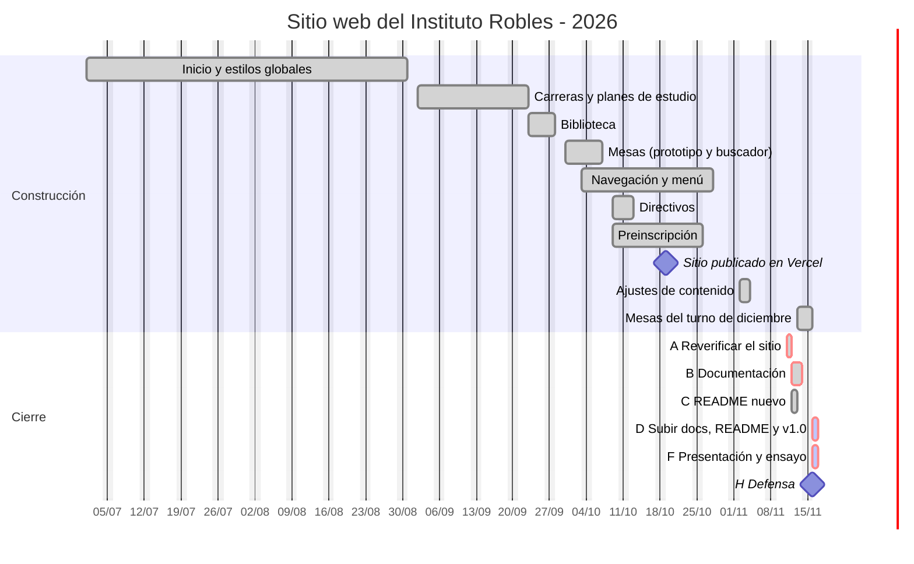
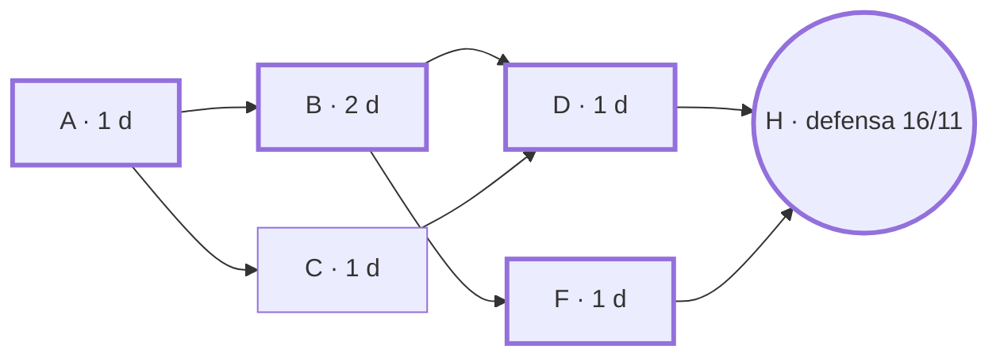
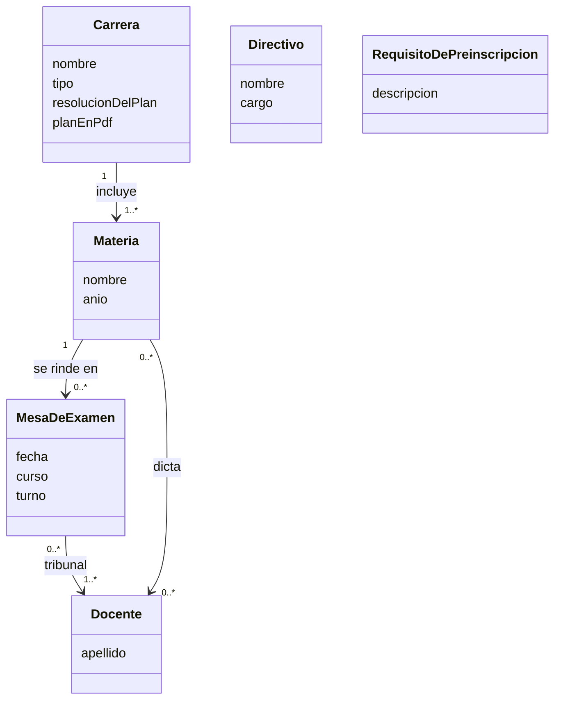

# Informe técnico final · Sitio web del Instituto Robles (Nivel Superior)

**Prácticas Profesionalizantes II** · Tecnicatura Superior en Análisis de Sistemas · Ciclo 2026 · TP9

| | |
|---|---|
| **Equipo** | Valentino Plescia (project manager, QA) · Germán Lauria (programador junior, PM 2.0, tester) · Tiago Bertoglio (analista funcional) · Anastasia Oldoni (diseñadora UX/UI) |
| **Cliente** | Docente de la cátedra, en nombre del Instituto |
| **Repositorio** | <https://github.com/IPFPR/IPFPR-web> (organización <https://github.com/IPFPR>) |
| **Sitio publicado** | <https://ipfpr-web.vercel.app> |
| **Versión** | 4.1 · 16/11/2026 (día de la defensa) · describe la rama `main` en el commit `7836d0b` |

Documentos que acompañan a este informe: [resumen ejecutivo](resumen-ejecutivo.md), [registro de decisiones](registro-de-decisiones.md) y [guía rápida](guia-rapida.md).

> **Cómo leer este informe.** El proyecto se construyó antes de planificarse: el docente pidió la página de manera informal y no hubo FODA, referente designado ni entrevistas. Por eso este informe distingue tres tipos de dato. **Verificado**: sale del código o del historial del repositorio. **Reconstruido**: lo estimó el equipo al cierre, porque no se registró en su momento (las horas, sobre todo). **Supuesto**: falta que el Instituto lo confirme. Cada tabla indica cuál usa.

## Contenido

- [Resumen ejecutivo](#resumen-ejecutivo)
- [1. La organización](#1-la-organización)
- [2. Diagnóstico](#2-diagnóstico-síntomas-causas-foda-y-cruce)
- [3. Proyecto propuesto](#3-proyecto-propuesto-alcance-exclusiones-supuestos-y-4p)
- [4. Metodología](#4-metodología-elegida-y-fundamentada)
- [5. Dimensionamiento](#5-dimensionamiento-puntos-función-y-métricas)
- [6. Estimación](#6-estimación-descomposición-tres-valores-cocomo-y-contraste)
- [7. Viabilidad y costos](#7-viabilidad-y-costos-cinco-dimensiones-y-recupero)
- [8. Plan de proyecto](#8-plan-de-proyecto-tareas-hitos-y-entregas)
- [9. Cronograma](#9-cronograma-gantt-pert-y-camino-crítico)
- [10. Organización del equipo](#10-organización-del-equipo-estructura-roles-y-matriz)
- [11. Riesgos](#11-riesgos-matriz-y-plan-de-rsgr)
- [12. Modelo del dominio](#12-modelo-del-dominio-diagrama-y-preguntas-pendientes)
- [13. Gestión de configuración](#13-gestión-de-configuración-líneas-base-cambios-y-auditoría)
- [14. Entrega, capacitación y mantenimiento](#14-plan-de-entrega-capacitación-y-mantenimiento)
- [15. Registro de decisiones técnicas](#15-registro-de-decisiones-técnicas)
- [16. Desvíos](#16-desvíos-qué-se-planificó-qué-ocurrió-y-por-qué)
- [17. Conclusiones](#17-conclusiones)
- Anexos: [A. Defectos](#anexo-a-registro-de-defectos) · [B. Preguntas para el Instituto](#anexo-b-preguntas-para-el-instituto) · [C. Verificación previa a la entrega](#anexo-c-lista-de-verificación-previa-a-la-entrega) · [D. Auditoría de documentación](#anexo-d-auditoría-de-documentación) · [E. Coherencia entre secciones](#anexo-e-verificación-de-coherencia-entre-secciones)

---

## Resumen ejecutivo

*Se entrega también como documento separado de una página: [resumen-ejecutivo.md](resumen-ejecutivo.md).*

**Recomendación.** Adoptar el sitio como canal oficial de información del Nivel Superior para el ciclo 2027. Está publicado desde el 19/10/2026, tiene ocho páginas y ya muestra las 90 mesas del turno de diciembre. Al Instituto no le cuesta dinero. Para que siga sirviendo dentro de un año hace falta una sola cosa que el equipo no puede resolver: que el Instituto designe a la persona que lo actualiza.

**Decisiones que se piden a la dirección.**

1. Designar a la persona que actualiza el sitio (unas 10 horas por año, con la guía rápida de una página).
2. Autorizar el cierre de los pendientes: 9 horas de correcciones y traspaso, a cargo del equipo.
3. Decidir si la preinscripción pasa a hacerse en línea. Hoy la página informa los requisitos y pide enviar la documentación por correo y entregarla en persona. El formulario en línea está construido en parte y desactivado hasta que funcione; para activarlo hace falta un aviso de privacidad, el consentimiento del aspirante (Ley 25.326) y una casilla oficial.
4. Confirmar qué casillas de correo son oficiales y a nombre de quién quedan las cuentas de GitHub y Vercel.

**Por qué.** El sitio resuelve lo que se pidió: información de las tres carreras con sus planes de estudio, biblioteca, autoridades, requisitos de preinscripción y mesas de examen con buscador. Su punto débil es operativo: cada dato se cambia editando un archivo. Ya se vio con las mesas: las fechas que había eran de prueba, se retiraron el 02/11 para no publicar datos falsos, y las reales, que llegaron el 15/11, las cargó un integrante del equipo y no el Instituto.

**Costo.** Dinero: $0 (alojamiento gratuito). Trabajo ya hecho: 156 horas del equipo, sin costo para el Instituto. Pendientes: 9 horas obligatorias y 12 opcionales, entre ellas la sección de contacto. Mantenimiento: 10 horas por año de una persona del Instituto.

**Alternativas evaluadas.** (A) Mantener el sitio actual con una guía de actualización: recomendada. (B) Pasar a un gestor de contenidos: se edita sin tocar archivos, pero exige servidor pago y rehacer el trabajo. (C) No adoptarlo: la información vuelve a circular solo por redes y en persona.

**Riesgos principales.** (1) Que nadie actualice el sitio. (2) Que se publiquen datos sin validación escrita del Instituto. (3) Que un cambio con errores salga publicado, porque cada cambio aprobado se publica solo. Los tres tienen plan en la sección 11.

**Lo que salió mal.** Se construyó antes de planificar: no hubo diagnóstico, alcance escrito ni estimación previa. Durante dos semanas el sitio mostró fechas de mesa de prueba. Los formularios de consulta de las tres carreras muestran un aviso de envío y no envían nada. Quedan cinco defectos abiertos, todos identificados y con horas asignadas.

**Límite de este análisis.** No hubo entrevistas con el Instituto. Si la dirección no designa un responsable, la recomendación cambia a la alternativa B.

---

## 1. La organización

Fuente: textos del sitio y pedido del docente. No hubo relevamiento formal (sección 16).

| Dato | Contenido | Tipo |
|---|---|---|
| Nombre | Instituto Parroquial Francisco de Paula Robles, Nivel Superior. El sitio usa tres variantes del nombre (DEF-05) | Verificado en el sitio |
| Dependencia | Institutos Parroquiales de Dolores · DIEGEP 4174 | Verificado en el sitio |
| Ubicación | Aristóbulo del Valle 350, Dolores, Provincia de Buenos Aires | Verificado en el sitio |
| Oferta | Tecnicatura Superior en Análisis de Sistemas · Tecnicatura Superior en Psicopedagogía · Profesorado de Educación Inicial | Verificado en el sitio |
| Atención presencial | 18:00 a 22:00 h (entrega de documentación de preinscripción) | Verificado en el sitio |
| Canales | Teléfono, correo, Facebook, Instagram y WhatsApp | Verificado en el sitio |
| Usuarios del sitio | Aspirantes, estudiantes, docentes y familias | Supuesto |
| Quien decide | Dirección del Instituto. Durante el proyecto la representó el docente de la cátedra | Verificado |
| Quien actualizará el sitio | Sin designar | Pendiente (R5) |

**Cómo se comunicó el equipo con el cliente.** Revisiones en clase, sección por sección. No quedaron actas. Es una falta de registro que se declara en la sección 16.

**Ética profesional.** El sitio publica nombres de directivos y de docentes de tribunales. El formulario de preinscripción, que está desactivado hasta que funcione (D-05), pediría DNI, domicilio y obra social: el equipo recomienda no activarlo sin aviso de privacidad ni autorización escrita del Instituto.

## 2. Diagnóstico: síntomas, causas, FODA y cruce

> **Limitación declarada.** El TP1 no se hizo en su momento. No hubo observación del trabajo en el Instituto ni entrevistas. Este diagnóstico se escribió al cierre y se apoya en lo que se puede comprobar: el código, el sitio publicado y el historial del repositorio. Las causas organizacionales son hipótesis que el Instituto tiene que confirmar (Anexo B).

### Hallazgos verificados al 16/11/2026

- El sitio es estático: ocho páginas HTML, una hoja de estilos compartida y JavaScript propio, sin base de datos. Se publica en Vercel desde la rama `main`.
- **Mesas de examen:** las fechas cargadas en septiembre eran de prueba y se retiraron el 02/11. Hoy hay 90 mesas reales del turno de diciembre de 2026 (22 de Análisis de Sistemas, 35 de Psicopedagogía y 33 de Educación Inicial), del 30/11 al 22/12, con materia, fecha, curso y docente. Tiene buscador por materia o docente, selector de carrera y ordenamiento. No publica horario.
- **Preinscripción:** la página informa la documentación requerida, pide enviarla a una casilla de correo y completar el trámite en persona. El formulario en línea (unos 40 campos, cuatro adjuntos, envío por el servicio externo FormSubmit) está desactivado desde el 26/10/2026 porque todavía no funciona y se pidió retirarlo; su código se conserva como comentario para terminarlo más adelante.
- **Formularios de consulta de las tres carreras:** al enviarlos muestran "¡Gracias por tu consulta! La administración se comunicará a la brevedad" y no envían nada.
- **Directivos:** nueve personas con nombre y cargo. Su sección de contacto está oculta desde el 04/11/2026. Cinco enlaces de "Contacto" apuntan a ella a propósito: quedan reservados para la sección de contacto que el equipo va a construir.
- **Menú:** está escrito a mano dentro de cada una de las ocho páginas. Se unificó el 28/10/2026, con versión para celulares.
- **Correos:** el sitio muestra cuatro casillas distintas según la página (administración, carreras, preinscripción y biblioteca).
- **Servicios externos:** Vercel, Tailwind (CDN), Google Fonts, Font Awesome, Google Maps y enlaces a WhatsApp, Facebook e Instagram.

### Síntomas, problemas y causas

| Síntoma (lo que se observa) | Problema | Causa |
|---|---|---|
| Del 19/10 al 02/11 el sitio publicado mostró fechas de mesa de prueba; del 02/11 al 15/11, ninguna | La página más consultada mostró datos falsos y después quedó vacía | Se usaron datos de prueba sin marcarlos como tales; las fechas reales dependen de que el Instituto las pase y alguien las cargue |
| Los formularios de consulta agradecen y no envían nada | Consultas de aspirantes que nadie recibe | Se construyeron como maqueta y nunca se les definió un destino |
| Cinco enlaces de "Contacto" llevan a una sección oculta | Mientras tanto, el usuario pulsa "Contacto" y no pasa nada | Decisión del equipo: se dejaron apuntando a la sección de contacto que se va a construir, para no tener que agregarlos después |
| Menús distintos y enlaces rotos entre páginas (corregido el 28/10) | La navegación dejó de ser confiable mientras el sitio crecía | El menú se copia a mano en cada página (D-02) |
| "Oferta Académica 2026" y "Ciclo Lectivo 2026" junto a "Inscripciones 2027" | Información que parece contradictoria | El año está escrito a mano en varios lugares |
| Cuatro casillas de correo y tres variantes del nombre institucional | El usuario no sabe cuál es el canal oficial | No hubo un referente que definiera los datos institucionales |
| El formulario de preinscripción se publicó el 21/10 sin terminar y sin aviso de privacidad | Un formulario que no funcionaba, y que terminado recogería datos personales | Se publicó como prototipo; cada integración a `main` sale a producción |

La causa que se repite es una sola: **el pedido fue informal y nunca hubo en el Instituto una persona que definiera el contenido, lo validara y se hiciera cargo de mantenerlo.**

### Matriz FODA

| | Favorable | Desfavorable |
|---|---|---|
| **Interno** | **Fortalezas** · F1 Sitio publicado, con publicación automática. · F2 Identidad visual coherente y adaptada a celulares. · F3 Mesas con buscador y datos del turno vigente. · F4 Historial completo en Git: 69 commits y 26 pull requests. · F5 Sin costo de infraestructura. | **Debilidades** · D1 El contenido se cambia editando HTML. · D2 Menú repetido en ocho archivos. · D3 Formularios de consulta que no envían. · D4 Enlaces de contacto que esperan una sección todavía no construida. · D5 Cuentas de Vercel y partes del sitio en manos de una persona. · D6 La mitad de los pull requests los integró su propio autor. |
| **Externo** | **Oportunidades** · O1 Preinscripción 2027 abierta: el sitio puede informar a los aspirantes. · O2 Turno de diciembre: los estudiantes necesitan las fechas. · O3 Redes sociales del Instituto para difundirlo. | **Amenazas** · A1 Que nadie del Instituto actualice el sitio. · A2 Que el plan gratuito de Vercel no admita uso institucional. · A3 Ley 25.326 si se reactiva el formulario sin consentimiento. · A4 Cambios o caídas de los servicios externos. |

### Cruce de la matriz

| | Oportunidades | Amenazas |
|---|---|---|
| **Fortalezas** | **FO.** Difundir la página de mesas (F3) antes del turno de diciembre (O2) por las redes del Instituto (O3). | **FA.** Usar el historial de Git (F4) y la guía rápida para que una persona del Instituto pueda actualizar sin depender del equipo (A1). |
| **Debilidades** | **DO.** Corregir formularios y enlaces (D3, D4) antes de difundir el sitio a los aspirantes 2027 (O1). | **DA.** Designar responsable, traspasar las cuentas (D5) y mantener desactivado el formulario hasta tener consentimiento (A3). |

**Estrategia priorizada: DA.** Las fortalezas ya están logradas; lo que decide si el sitio sirve en 2027 es quién lo mantiene.

## 3. Proyecto propuesto: alcance, exclusiones, supuestos y 4P

> El TP2 no se hizo antes de construir. El alcance se definió sobre la marcha y se escribe acá tal como quedó. Cada enunciado indica cómo se verifica y si se cumple hoy.

### Objetivo

Que el Instituto cuente con un sitio web actualizado y de aspecto profesional para el Nivel Superior, que reúna la información que hoy está dispersa y que pueda mantenerse en el tiempo.

### Alcance incluido

| Incluye | Cómo se verifica | ¿Se cumple al 16/11? |
|---|---|---|
| Inicio con presentación, oferta académica, acceso a preinscripción y mapa | Cada botón y enlace abre una página o sección que existe | Sí; el enlace de contacto del pie espera la sección prevista (DEF-10) |
| Una página por carrera con materias, docentes y plan de estudios en PDF | El PDF se abre desde el sitio publicado | Sí |
| Biblioteca | Se abre desde el menú de las ocho páginas | Sí |
| Mesas de examen con buscador, selector de carrera y ordenamiento | Buscar "Inglés" muestra solo esas mesas; las fechas son del turno vigente | Sí |
| Preinscripción con requisitos y forma de entrega | La página dice qué documentación presentar, a qué correo y en qué horario | Sí |
| Directivos | Nombre y cargo de cada autoridad | Sí, falta validación escrita (R6) |
| Diseño adaptable a celulares | A 360 px de ancho hay menú desplegable y no hay desplazamiento horizontal | Sí |
| Repositorio con README y documentación en texto | Un tercero entiende el proyecto leyendo el README | Sí, desde esta entrega |

### Alcance excluido

- Inscripción en línea con base de datos o panel de administración.
- Preinscripción por formulario en línea: construida en parte, desactivada hasta que funcione y conservada en el código para una etapa siguiente (D-05).
- Sección de contacto: prevista para una etapa siguiente; los enlaces ya están puestos.
- Consultas por formulario: hoy no funcionan y se decide entre ocultarlas o conectarlas (P2).
- Dominio propio.
- Mantenimiento del sitio por parte del equipo después de la entrega.
- Horario y aula de cada mesa, y turnos anteriores.

### Supuestos

| # | Supuesto | Riesgo que lo cubre |
|---|---|---|
| S1 | El Instituto provee y valida el contenido (mesas, requisitos, directivos) | R6 |
| S2 | Hay una persona con capacidad de decisión disponible para validar | R8 |
| S3 | Las imágenes y los planes en PDF forman parte del repositorio (verificado) | R1 |
| S4 | El plan gratuito de Vercel alcanza y está permitido para un sitio institucional | R2 |
| S5 | La casilla de preinscripción que muestra la página es la oficial | R9 |
| S6 | El Instituto designa a una persona que actualiza el sitio | R5 |

### Análisis con las 4P

| P | Situación |
|---|---|
| **Personal** | Cuatro integrantes con roles definidos (sección 10). En la práctica los cuatro programaron. El docente actuó como cliente. No hay referente en el Instituto. |
| **Producto** | Sitio informativo de ocho páginas. Lo que cambia: mesas (tres turnos por año), año de inscripción (una vez por año), directivos y docentes (ocasional). |
| **Proceso** | Incremental, una sección por vez, con ramas y pull requests (sección 4). |
| **Proyecto** | Inicio 01/07/2026 · publicación 19/10/2026 · cierre documental 16/11/2026 · 156 horas (sección 6). |

## 4. Metodología elegida y fundamentada

El equipo no eligió una metodología al inicio. Lo que hizo corresponde a un **modelo incremental**: construyó el sitio por partes (inicio, carreras, biblioteca, mesas, directivos, preinscripción) y mostró cada una al docente antes de seguir. El historial lo respalda: una rama por integrante o por tema, y 26 pull requests.

| Pregunta | Respuesta para este proyecto | Qué indica |
|---|---|---|
| ¿Requerimientos claros y estables? | No. El pedido fue informal y creció: mesas, preinscripción y directivos se agregaron después | Descarta cascada |
| ¿Cliente disponible de forma continua? | En parte: el docente revisó por etapas, en clase | Permite entregas parciales |
| ¿Hace falta mostrar valor temprano? | Sí: cada sección se mostró apenas estuvo | Incremental |
| ¿Alcance y precio cerrados por contrato? | No | No exige plan rígido |
| ¿Equipo con experiencia en ágil? | No. No hubo roles ni ceremonias de Scrum | Descarta Scrum completo |

**Por qué incremental y no Scrum.** Scrum pide un dueño de producto disponible, sprints de duración fija y reuniones periódicas. El equipo no tuvo ninguna de las tres cosas y decirlo sería falso. Lo que sí hubo fue entrega por incrementos con revisión del cliente.

**Lo que faltó.** El modelo incremental también pide planificar cada incremento y registrar lo que el cliente dice en cada revisión. No se hizo. La decisión D-06 lo registra como algo que el equipo hoy haría distinto.

## 5. Dimensionamiento: puntos función y métricas

> El TP4 no se hizo antes de construir. El conteo se hizo al cierre, sobre el producto terminado. Sirve como medida del tamaño y como base para estimar trabajos parecidos.

### Conteo de puntos función

| Parámetro | Qué se cuenta en este sitio | Cantidad | Complejidad | Peso | Subtotal |
|---|---|---|---|---|---|
| Entradas | Formulario de preinscripción (unos 40 campos, 4 adjuntos; construido y desactivado) | 1 | Alta | 6 | 6 |
| Entradas | Formulario de consulta (el mismo en las tres carreras) | 1 | Simple | 3 | 3 |
| Salidas | Páginas informativas: inicio, tres carreras, biblioteca, preinscripción, directivos | 7 | Simple | 4 | 28 |
| Salidas | Página de mesas (90 filas, por carrera y año) | 1 | Media | 5 | 5 |
| Consultas | Mesas: buscador, selector de carrera, ordenamiento | 3 | Simple | 3 | 9 |
| Archivos lógicos internos | Mesas de examen, guardadas dentro del HTML | 1 | Simple | 7 | 7 |
| Interfaces externas | Google Maps, redes y WhatsApp, FormSubmit (inactivo), CDN de estilos y fuentes | 4 | Simple | 5 | 20 |
| **Cuenta total** | | | | | **78** |

### Factores de ajuste (0 = sin influencia, 5 = esencial)

| # | Factor | Valor | Justificación |
|---|---|---|---|
| 1 | Copias de seguridad y recuperación | 1 | Git conserva todo el historial; no hay datos propios que respaldar |
| 2 | Comunicaciones de datos | 3 | Sitio web público |
| 3 | Procesamiento distribuido | 0 | No hay |
| 4 | Rendimiento crítico | 1 | Páginas livianas, sin exigencia especial |
| 5 | Entorno operativo muy utilizado | 1 | Alojamiento compartido y gratuito |
| 6 | Entrada de datos interactiva | 2 | Dos formularios |
| 7 | Entradas en varias pantallas | 1 | El formulario de preinscripción es largo, en una sola página |
| 8 | Actualización interactiva de archivos | 0 | El contenido no se edita desde el sitio |
| 9 | Complejidad de entradas, salidas y consultas | 1 | Solo la página de mesas |
| 10 | Procesamiento interno complejo | 0 | Filtrar y ordenar una tabla |
| 11 | Código reutilizable | 2 | Hoja de estilos compartida; el menú no se reutiliza (D-02) |
| 12 | Conversión e instalación | 1 | Publicación automática |
| 13 | Instalaciones múltiples | 1 | Un solo sitio, usado desde computadoras y celulares |
| 14 | Facilidad de cambio y de uso | 3 | Tiene que poder mantenerlo una persona no técnica |
| | **Σ Fi** | **17** | |

**PF = 78 × (0,65 + 0,01 × 17) = 78 × 0,82 = 64 puntos función.**

### Métricas del proyecto

| Métrica | Valor | Fuente |
|---|---|---|
| Tamaño funcional | 64 PF | Conteo de esta sección |
| Tamaño en líneas | 4.874 líneas (4.505 de HTML y 369 de CSS); 491 de ellas son JavaScript | `wc -l` sobre `main` |
| Esfuerzo | 156 h (126 de construcción y 30 de documentación y cierre) | Reconstruido, sección 6 |
| Productividad de construcción | 126 h ÷ 64 PF = 2,0 h por PF | Calculado |
| Duración | 20 semanas (01/07 al 16/11/2026) | Historial |
| Commits | 69: 39 de trabajo y 30 fusiones | Historial |
| Pull requests | 26 | Historial |
| Defectos registrados | 15: 8 cerrados, 5 abiertos y 2 aceptados por decisión del equipo | Anexo A |
| Densidad de defectos | 15 ÷ 64 PF = 0,23 por PF | Calculado |
| Páginas terminadas sobre previstas | 8 de 8 | Sección 8 |

## 6. Estimación: descomposición, tres valores, COCOMO y contraste

> **No hubo estimación previa y no se registraron horas.** Lo que sigue tiene dos partes distintas: el esfuerzo del trabajo hecho, que el equipo **reconstruyó** al cierre a partir del historial, y la estimación con tres valores del trabajo que **falta**.

### 6.1 Trabajo realizado: esfuerzo reconstruido

Método: se agruparon los 39 commits de trabajo por tarea y el equipo asignó horas a cada grupo. El total equivale a unas dos horas semanales por integrante durante 20 semanas, que es consistente con el ritmo real de trabajo en clase y fuera de ella. El margen de error es alto (±30 %) y se declara.

| # | Tarea | Período | Horas |
|---|---|---|---|
| 1 | Inicio y estilos globales | 01/07 al 31/08 | 16 |
| 2 | Tres páginas de carreras y planes de estudio en PDF | 02/09 al 23/09 | 30 |
| 3 | Biblioteca | 23/09 al 28/09 | 8 |
| 4 | Mesas de examen: prototipo, buscador y filtros, carga del turno de diciembre | 30/09 al 16/11 | 18 |
| 5 | Preinscripción: prototipo, formulario, desactivación | 09/10 al 04/11 | 16 |
| 6 | Directivos | 13/10 al 04/11 | 8 |
| 7 | Navegación: logo, menú unificado y menú para celulares | 03/10 al 28/10 | 14 |
| 8 | Paso a la organización de GitHub y publicación en Vercel | 17/10 al 19/10 | 4 |
| 9 | Revisión de pull requests, pruebas y correcciones | Todo el período | 12 |
| | **Subtotal construcción** | | **126** |
| 10 | Documentación y cierre (TP9) | 11/11 al cierre | 30 |
| | **Total del proyecto** | | **156** |

### 6.2 Trabajo pendiente: estimación con tres valores

E = (O + 4M + P) ÷ 6, en horas.

| # | Tarea pendiente | Defectos | O | M | P | E |
|---|---|---|---|---|---|---|
| P1 | Habilitar la sección de contacto prevista, a la que ya apuntan los cinco enlaces | DEF-10 | 0,5 | 1 | 2 | 1,1 |
| P2 | Formularios de consulta: ocultarlos o conectarlos a una casilla | DEF-11 | 1 | 2 | 4 | 2,2 |
| P3 | Unificar nombre institucional, años y casillas de correo | DEF-04, 05, 12 | 0,5 | 1 | 3 | 1,3 |
| P4 | Mover los scripts dentro de `<body>` y borrar comentarios obsoletos | DEF-14 | 0,5 | 1 | 2 | 1,1 |
| P7 | Capacitar a la persona del Instituto y traspasar las cuentas | — | 2 | 3 | 6 | 3,3 |
| | **Subtotal obligatorio** | | | | | **9** |
| P5 | Menú único compartido por las ocho páginas (revierte D-02) | — | 3 | 6 | 12 | 6,5 |
| P6 | Terminar la preinscripción en línea, con aviso de privacidad y consentimiento | DEF-08, 09, 15 | 3 | 5 | 10 | 5,5 |
| | **Subtotal opcional** (depende de decisiones del Instituto) | | | | | **12** |
| | **Total pendiente** | | | | | **21** |

### 6.3 COCOMO básico, modo orgánico

Corresponde el modo orgánico: equipo chico, problema conocido, sin restricciones rígidas. E = 2,4 × KLDC^1,05 (personas-mes) y T = 2,5 × E^0,38 (meses). Se toma 1 persona-mes = 152 horas.

| Qué se cuenta como código | KLDC | Esfuerzo | Duración |
|---|---|---|---|
| Solo JavaScript y CSS (lo que tiene lógica o reglas) | 0,86 | 2,05 pm = 311 h | 3,3 meses |
| Todas las líneas, incluido el HTML | 4,87 | 12,7 pm = 1.924 h | 6,6 meses |

### 6.4 Contraste

| Método | Resultado |
|---|---|
| Reconstrucción por tareas (6.1) | 156 h |
| Puntos función con la productividad medida (64 PF × 2,0 h) | 126 h de construcción: es el mismo dato, no una estimación independiente |
| COCOMO sobre JavaScript y CSS | 311 h |
| COCOMO sobre todas las líneas | 1.924 h |

**Lectura.** COCOMO sobre todas las líneas no sirve para este producto: el HTML es contenido, no lógica, y el menú está copiado ocho veces. COCOMO sobre JavaScript y CSS da el doble de lo real. La diferencia tiene explicación: el modelo supone un proceso profesional completo, con análisis, diseño, pruebas y gestión, y este proyecto se salteó casi todo eso (sección 16). Las 155 horas de diferencia son una medida aproximada de lo que no se hizo.

**Valor que usan las demás secciones:** 156 h realizadas, 21 h pendientes (9 obligatorias y 12 opcionales) y 10 h por año de mantenimiento (sección 14).

## 7. Viabilidad y costos: cinco dimensiones y recupero

> El TP5 se hace al cierre. Se evalúa la viabilidad de **adoptar y mantener** el sitio, que es la decisión que hoy tiene que tomar la dirección.

### Cinco dimensiones

| Dimensión | Evaluación | Conclusión |
|---|---|---|
| **Técnica** | Tecnología simple, sin servidor ni base de datos. El sitio existe y funciona. Depende de servicios externos gratuitos (R2). | Viable |
| **Operativa** | Es la dimensión crítica. Alguien del Instituto tiene que editar un archivo tres veces por año (mesas) y una vez por año (inscripción). La guía rápida lo reduce a 5 o 10 minutos por cambio, pero la persona no está designada. | **Condicionada** a designar responsable |
| **Económica** | $0 de alojamiento. El trabajo fue académico y no se cobra. El plan gratuito de Vercel (Hobby) está pensado para uso personal no comercial; si no admite un sitio institucional, el plan Pro cuesta USD 20 por mes (precio publicado por Vercel, consultado el 11/11/2026) y la alternativa gratuita es GitHub Pages. | Viable |
| **Temporal** | El sitio se publicó el 19/10 y las mesas reales se cargaron el 15/11, quince días antes de la primera mesa (30/11). Llega a tiempo para el turno de diciembre y para la preinscripción 2027. | Viable |
| **Legal** | Hoy el sitio no recoge datos personales: el formulario está desactivado. Publica nombres de nueve directivos y de los docentes de los tribunales, sin autorización escrita. Cuando se active el formulario, aplica la Ley 25.326: aviso de privacidad y consentimiento. | Viable con autorización escrita |

### Estructura de costos

Valor hora de referencia: **USD 10**. Es un supuesto del equipo para poder comparar; ningún integrante cobró.

| Concepto | Tipo | Horas | Valorizado | ¿Lo paga el Instituto? |
|---|---|---|---|---|
| Construcción y documentación | Una vez | 156 | USD 1.560 | No: trabajo académico |
| Pendientes obligatorios (P1 a P4 y P7) | Una vez | 9 | USD 90 | No: los hace el equipo |
| Pendientes opcionales (P5 y P6) | Una vez | 12 | USD 120 | A definir |
| Alojamiento | Recurrente | — | USD 0 por año (USD 240 si hiciera falta el plan Pro) | No, salvo plan Pro |
| Mantenimiento de contenido | Recurrente | 10 por año | USD 100 por año | Sí: tiempo de su personal |
| Tiempo del Instituto para validar y capacitarse | Una vez | 3 | USD 30 | Sí: costo de oportunidad |

**Costo total valorizado:** 156 + 21 = 177 h = USD 1.770. **Desembolso del Instituto:** USD 0.

### Alternativas

| Alternativa | Costo inicial | Costo anual | Ventaja | Desventaja |
|---|---|---|---|---|
| **A. Sitio actual con guía de actualización** (recomendada) | 9 h del equipo | 10 h del Instituto | Ya está hecho; sin costo en dinero | Cada cambio exige editar un archivo |
| B. Gestor de contenidos | Rehacer el sitio: no menos de las 126 h de construcción | Servidor pago y actualizaciones de seguridad | Se edita desde un panel, sin tocar archivos | Más caro, más frágil y hay que rehacer lo hecho |
| C. No adoptarlo | 0 | 0 | Ninguna | Se pierden las 156 h y la información vuelve a estar dispersa |

### Recupero

- **En dinero:** el Instituto no desembolsa nada, de modo que no hay inversión que recuperar.
- **Valorizado:** si el sitio le ahorra a la secretaría 4 horas por mes de responder consultas sobre mesas, requisitos y planes (supuesto, no medido), el beneficio es de USD 40 por mes. Descontado el mantenimiento (USD 100 por año), quedan USD 31,7 por mes. Recupero = 1.770 ÷ 31,7 = **56 meses**.

**Lectura honesta.** Medido solo como ahorro de horas, el proyecto tarda más de cuatro años en recuperarse. El ahorro no es lo que lo justifica. Lo justifica que un aspirante encuentre las carreras, los planes y los requisitos sin ir al Instituto, y que no le cueste dinero a la institución. Ese beneficio no se midió y el equipo no le pone número.

## 8. Plan de proyecto: tareas, hitos y entregas

> El TP3 no se hizo. No existe un plan inicial contra el cual comparar. La tabla muestra lo que ocurrió, con fechas del historial, y el plan del tramo de cierre, que sí se planificó.

### Estado de las páginas

| Página | Primer commit | Último cambio | Estado | Pendiente |
|---|---|---|---|---|
| Inicio (`index.html`) | 08/07 | 04/11 | Publicada | DEF-04, DEF-10 |
| Análisis de Sistemas | 02/09 | 04/11 | Publicada | DEF-11 |
| Educación Inicial | 07/09 | 04/11 | Publicada | DEF-11 |
| Psicopedagogía | 08/09 | 04/11 | Publicada | DEF-11 |
| Biblioteca | 28/09 | 28/10 | Publicada | DEF-12 |
| Mesas de examen | 30/09 | 15/11 | Publicada, con las fechas reales del turno de diciembre | DEF-10 |
| Preinscripción | 09/10 | 04/11 | Publicada; formulario desactivado hasta que funcione | DEF-10 |
| Directivos | 13/10 | 04/11 | Publicada; sección de contacto pendiente | DEF-10 |

### Hitos y entregables

| # | Hito | Entregable | Fecha | Estado | Responsable |
|---|---|---|---|---|---|
| H1 | Inicio del proyecto | Repositorio creado | 01/07 | Hecho | Valentino |
| H2 | Primera página | `index.html` y `styles.css` | 08/07 | Hecho | Germán |
| H3 | Rediseño general | Paleta bordó y dorado | 31/08 | Hecho | Valentino |
| H4 | Carreras | Tres páginas y tres planes en PDF | 23/09 | Hecho | Anastasia, Germán, Tiago |
| H5 | Biblioteca | `biblioteca.html` | 28/09 | Hecho | Tiago |
| H6 | Mesas con buscador | `mesasexamen.html` | 07/10 | Hecho | Valentino |
| H7 | Directivos | `directivos.html` | 13/10 | Hecho | Anastasia |
| H8 | **Sitio publicado** | Organización IPFPR y ipfpr-web.vercel.app | 19/10 | Hecho | Germán |
| H9 | Preinscripción | `preinscripciones.html` | 21/10 | Hecho; formulario desactivado el 26/10 hasta que funcione | Tiago, Anastasia |
| H10 | Navegación unificada | Mismo menú en ocho páginas y menú para celulares | 28/10 | Hecho | Germán |
| H11 | Turno de diciembre | 90 mesas con las fechas reales | 16/11 | Hecho (PR #26) | Tiago; revisó Valentino |
| H12 | Documentación en el repositorio | Carpeta `docs/` y README nuevo | 16/11 | Antes de la defensa | Tiago y Valentino |
| H13 | Línea base de producto | Etiqueta `v1.0` | 16/11 | Antes de la defensa | Valentino |
| H14 | Defensa oral | Presentación | 16/11 | Hoy | Los cuatro |
| H15 | Pendientes obligatorios y traspaso | P1 a P4 y P7 cerrados | Después de la defensa, antes del 30/11 | Planificado | Germán y Tiago |

## 9. Cronograma: Gantt, PERT y camino crítico

### Gantt de lo ocurrido y del cierre

### Red de tareas del cierre (PERT)

El cierre empezó el miércoles 11/11/2026 y la defensa quedó fijada para el lunes 16/11: cuatro días hábiles. Duraciones en días hábiles; las horas suman 30, que es la tarea 10 de la sección 6.

| Tarea | Descripción | Predecesoras | Días | Horas | ES | EF | LS | LF | Holgura |
|---|---|---|---|---|---|---|---|---|---|
| **A** | Reverificar el sitio contra `main` (Anexo A) | — | 1 | 2 | 0 | 1 | 0 | 1 | **0** |
| **B** | Escribir informe, resumen, registro de decisiones y guía | A | 2 | 14 | 1 | 3 | 1 | 3 | **0** |
| C | Escribir el README nuevo | A | 1 | 3 | 1 | 2 | 2 | 3 | 1 |
| **D** | Subir `docs/` y README por pull request con revisor y crear la etiqueta `v1.0` | B, C | 1 | 2 | 3 | 4 | 3 | 4 | **0** |
| **F** | Preparar la presentación y ensayarla | B | 1 | 8 | 3 | 4 | 3 | 4 | **0** |
| **H** | Defensa oral | D, F | 0 | 1 | 4 | 4 | 4 | 4 | **0** |

**Camino crítico: A → B → D → H y A → B → F → H, 4 días hábiles.** Solo el README (C) tuvo holgura. Con la defensa fijada para el 16/11 no quedó margen: la presentación y el ensayo se hicieron el mismo día que la subida de la documentación, y un atraso de medio día en B se habría trasladado entero a la defensa. Es un desvío de tiempos y está en la sección 16.

## 10. Organización del equipo: estructura, roles y matriz

**Estructura.** Equipo descentralizado democrático: cuatro pares, sin jefe técnico, con decisiones por acuerdo. Es la estructura adecuada para un equipo chico con un problema de dificultad baja. Con 4 personas hay 4 × 3 ÷ 2 = **6 canales de comunicación**. El equipo coordinó en clase y dejó registro del trabajo en los pull requests.

### Roles

| Integrante | Rol | Qué responde |
|---|---|---|
| **Valentino Plescia** | Project manager · QA · gestión de tiempos y recursos · aseguramiento de la calidad del software | Que el trabajo llegue en fecha y que lo que se integra a `main` haya sido revisado |
| **Germán Lauria** | Programador junior · project manager 2.0 (segundo del PM y su reemplazo) · tester | Código, pruebas del sitio publicado y publicación en Vercel |
| **Tiago Bertoglio** | Analista funcional | Qué tiene que hacer cada página y que el contenido sea el correcto |
| **Anastasia Oldoni** | Diseñadora UX/UI | Identidad visual, navegación y experiencia de uso |

### Matriz de responsabilidades

R = hace · A = aprueba · C = se lo consulta · I = se lo informa

| Actividad | Valentino | Germán | Tiago | Anastasia |
|---|---|---|---|---|
| Conducción, tiempos y recursos | **R / A** | R (reemplazo) | I | I |
| Análisis funcional y contenido | A | C | **R** | C |
| Diseño visual y navegación | A | C | C | **R** |
| Programación de páginas | I | **R** | R | R |
| Pruebas del sitio publicado | A | **R** | C | I |
| Revisión de pull requests y calidad | **R / A** | R | I | I |
| Publicación (Vercel) | I | **R / A** | I | I |
| Repositorio y organización de GitHub | **R / A** | C | I | I |
| Documentación (TP9) | A | C | **R** | C |
| Defensa oral | R | R | R | R |

### Lo que muestra el historial

| Integrante | Commits de trabajo | Áreas |
|---|---|---|
| Anastasia Oldoni | 14 | Análisis de Sistemas, directivos, logo y escudo, navegación |
| Tiago Bertoglio | 10 | Psicopedagogía, biblioteca, preinscripción, mesas del turno de diciembre |
| Germán Lauria | 9 | Inicio, Educación Inicial, menú unificado y para celulares, correcciones |
| Valentino Plescia | 6 | Rediseño general, mesas (prototipo y buscador), menú y pie |
| **Total** | **39** | Más 30 fusiones |

**Diferencia entre roles y práctica.** Los roles ordenaron quién decide, no quién programa: los cuatro escribieron código. La cantidad de commits no mide esfuerzo; un commit de Valentino con el buscador de mesas pesa más que varios de ajuste visual.

**Dependencia de una sola persona (R7).** El proyecto de Vercel lo creó Germán y solo él lo administra. El buscador de mesas lo escribió Valentino. Antes del traspaso, un segundo integrante tiene que poder operar cada una de esas partes.

## 11. Riesgos: matriz y plan de RSGR

> El TP7 se hace al cierre. La matriz mira hacia adelante: son los riesgos de adoptar y mantener el sitio. Lo que ya ocurrió está en la sección 16.4.

Probabilidad de 10 a 90 %. Impacto: 1 despreciable, 2 marginal, 3 crítico, 4 catastrófico. Exposición = probabilidad × impacto. Prioridad alta desde 1,20; media de 0,60 a 1,19; baja por debajo de 0,60.

| # | Riesgo: que ocurra X y, como consecuencia, Y | Categoría | Prob. | Imp. | Expos. | Prioridad |
|---|---|---|---|---|---|---|
| R5 | Que el Instituto no designe a quien actualiza, y las mesas y la inscripción queden vencidas | Negocio | 70 % | 3 | 2,10 | Alta |
| R6 | Que se publiquen mesas, directivos o requisitos sin validar, y el sitio informe datos erróneos o de personas que no lo autorizaron | Negocio | 50 % | 3 | 1,50 | Alta |
| R8 | Que no haya un referente con tiempo, y toda validación dependa del docente | Personal | 70 % | 2 | 1,40 | Alta |
| R7 | Que falte la única persona que conoce Vercel o el buscador de mesas, y esa parte no pueda mantenerse | Personal | 40 % | 3 | 1,20 | Alta |
| R10 | Que se integre a `main` un cambio con errores sin que otro lo revise, y salga publicado al instante | Técnico | 40 % | 3 | 1,20 | Alta |
| R3 | Que lleguen pedidos de cambio sin registrarse, y el alcance crezca sin control | Proyecto | 50 % | 2 | 1,00 | Media |
| R2 | Que Vercel, Tailwind, Google Fonts, Font Awesome o Google Maps cambien sus condiciones o fallen, y el sitio pierda disponibilidad o estilos | Técnico | 30 % | 3 | 0,90 | Media |
| R9 | Que se reactive el formulario sin aviso de privacidad ni consentimiento, y se incumpla la Ley 25.326 | Legal | 20 % | 4 | 0,80 | Media |
| R4 | Que la documentación no esté completa para la defensa | Proyecto | 20 % | 3 | 0,60 | Media |
| R1 | Que falten imágenes o planes en el repositorio, y el sitio muestre enlaces rotos | Técnico | 10 % | 3 | 0,30 | Baja |

R9 tiene impacto catastrófico: se informa a la dirección aunque su probabilidad sea baja.

### Plan de reducción, supervisión y gestión (RSGR)

| Riesgo | Reducción | Supervisión | Gestión si ocurre | Responsable |
|---|---|---|---|---|
| **R5** Sin responsable | Pedir a la dirección una designación por escrito. Entregar la guía rápida y una hora de práctica. | ¿Hay una persona designada? Alerta: no la hay al día de la defensa. | Dejar constancia escrita, ofrecer la alternativa B y publicar en la página de mesas la fecha de última actualización. | Valentino |
| **R6** Datos sin validar | Antes de publicar, pedir confirmación escrita de mesas, requisitos y directivos. | Datos con validación escrita sobre datos publicados. Alerta: hoy es 0 de 3. | Retirar el dato dudoso hasta confirmarlo. | Tiago |
| **R8** Sin referente | Pedir un referente con nombre y un medio de contacto. Usar las preguntas del Anexo B. | Días sin respuesta a una consulta. Alerta: más de 7. | Escalar al docente y registrar la decisión que se tomó sin validación. | Valentino |
| **R7** Persona única | Agregar un segundo administrador en Vercel y en la organización de GitHub. El README describe la publicación. | Cantidad de personas con acceso a cada cuenta. Alerta: 1. | El sitio sigue publicado aunque nadie lo administre; se recupera el acceso desde la organización de GitHub. | Germán |
| **R10** Cambio sin revisión | Regla: nadie integra lo que escribió. Protección de la rama `main` con un revisor obligatorio. | Pull requests integrados por su autor. Hasta el #25: cerca de la mitad. El #26 ya tuvo revisor. | Volver al despliegue anterior desde Vercel o revertir el commit. | Valentino |

Los supuestos S1 a S6 de la sección 3 están cubiertos por R6, R8, R1, R2, R9 y R5.

## 12. Modelo del dominio: diagrama y preguntas pendientes

Modelo construido a partir de lo que el sitio muestra. No lo validó nadie del Instituto.

| Clase | Definición | Atributos |
|---|---|---|
| Carrera | Propuesta de formación que ofrece el Instituto | nombre, tipo (tecnicatura o profesorado), resolución del plan, PDF del plan |
| Materia | Unidad curricular de una carrera, ubicada en un año | nombre, año |
| Docente | Persona que dicta una materia o integra un tribunal | apellido |
| Mesa de examen | Fecha en la que se rinde el final de una materia | fecha, curso, turno |
| Directivo | Persona con un cargo de conducción o administración | nombre, cargo |
| Requisito de preinscripción | Documento que el aspirante tiene que presentar | descripción |

Preinscripción dejó de ser una clase con datos del aspirante: el sitio ya no los recibe. Quedó como una lista de requisitos.

### Preguntas que el modelado hizo aparecer

1. La mesa muestra uno o dos apellidos. ¿Es el tribunal completo o solo quien preside?
2. Las mesas no publican horario ni aula. ¿El Instituto quiere que figuren?
3. Hay materias con el mismo nombre en más de una carrera (Formación Religiosa, Pedagogía y Filosofía, por ejemplo). ¿Comparten mesa o son mesas distintas?
4. ¿Los requisitos de preinscripción son los mismos para las tres carreras?
5. ¿Quién autoriza publicar los nombres de docentes y directivos?
6. ¿Cuál de las cuatro casillas de correo es la oficial para cada trámite?

## 13. Gestión de configuración: líneas base, cambios y auditoría

### Elementos de configuración

| Categoría | Elementos |
|---|---|
| Código | `index.html`, `interfazanalista.html`, `interfazedinicial.html`, `interfazpsicopedagogia.html`, `biblioteca.html`, `mesasexamen.html`, `preinscripciones.html`, `directivos.html`, `styles.css` |
| Recursos | `images/` (logo y escudo) · `planes_de_estudio/` (un PDF por carrera) |
| Documentación | `README.md` · `docs/informe-tecnico-final.md` · `docs/resumen-ejecutivo.md` · `docs/registro-de-decisiones.md` · `docs/guia-rapida.md` |
| Modelos | Diagramas de clases, Gantt y red de tareas, en texto (Mermaid) dentro del informe |
| Publicación | Proyecto de Vercel conectado a la rama `main` |

### Cómo se trabajó (verificado en el historial)

- 69 commits entre el 01/07 y el 16/11/2026: 39 de trabajo y 30 fusiones.
- 26 pull requests, con ramas por integrante (`ana`, `german`, `tiago`) o por tema (`biblioteca`, `ramaanalistas`, `prototipos`, `prototipoPreinscripcion`, `mejoras`).
- El repositorio nació en una cuenta personal y pasó a la organización IPFPR el 19/10/2026: los pull requests #1 a #14 figuran en la cuenta anterior y del #15 en adelante en la organización.
- Cada integración a `main` se publica sola en Vercel.
- Cerca de la mitad de los pull requests los integró su propio autor. El #26, el último, lo escribió Tiago y lo integró Valentino.
- No hubo etiquetas hasta esta entrega.

### Reglas de trabajo desde esta entrega

1. Todo cambio entra por pull request desde una rama propia.
2. Nadie integra lo que escribió: aprueba otro integrante (R10).
3. El mensaje del commit dice qué cambió. "me faltó edte" no alcanza.
4. Si el cambio modifica lo que el sitio hace, la documentación se actualiza en el mismo pull request.
5. Los nombres de archivo van en minúsculas y sin espacios: Vercel distingue mayúsculas y un enlace que funciona en Windows puede fallar publicado.

### Líneas base

| Línea base | Contenido | Identificación | Aprobó |
|---|---|---|---|
| Funcional | Alcance | No existió: el alcance no se escribió antes de construir | — |
| De producto, primera publicación | Sitio publicado | Integración del 19/10/2026 (PR #17, commit `0c0690c`) | Docente, en clase, sin constancia escrita |
| **De producto, entrega** | Ocho páginas con el turno de diciembre más la documentación | Etiqueta `v1.0`, sobre el commit que integra `docs/` | Equipo |

### Registro de cambios

No se llevó registro mientras ocurrían. Se reconstruyó desde el historial; quién pidió cada cambio no quedó anotado.

| # | Fecha | Cambio | Commit · PR | Impacto |
|---|---|---|---|---|
| C1 | 07/10 | Buscador y filtros en mesas | `aa1a195` · #16 | Amplió el alcance |
| C2 | 09/10 al 21/10 | Formulario de preinscripción con adjuntos | `e987582`, `baa9171` · #18 | Amplió el alcance; trajo datos personales |
| C3 | 26/10 | Formulario de preinscripción desactivado y conservado como comentario | `3b18e88` · #21 | Pospuso esa parte del alcance (D-05) |
| C4 | 28/10 | Menú corregido y menú para celulares | `834bd45` · #23 | Cerró DEF-01 y DEF-03 |
| C5 | 02/11 | Fechas de prueba de las mesas borradas; correo agregado en preinscripción | `7f1b93e` · #24 | Se dejó de mostrar datos falsos; mesas sin fechas hasta el 15/11 |
| C6 | 04/11 | Botón de preinscripción solo en inicio y carreras; contacto de directivos oculto, con los enlaces reservados para la sección futura | `f200ddd` · #25 | DEF-10, aceptado |
| C7 | 15/11 | 90 mesas con las fechas reales del turno de diciembre; la columna Horario pasó a ser Curso | `970ed96` · #26 | Cerró DEF-13 |

### Auditoría de configuración

| Fecha | Qué se auditó | Resultado |
|---|---|---|
| 11/11/2026 | Ocho páginas contra el registro de defectos | 5 cerrados y 8 abiertos |
| 16/11/2026 | Ocho páginas en `main` (`7836d0b`) contra el registro y contra este informe | 8 cerrados, 5 abiertos y 2 aceptados. Se corrigieron errores de la versión 3.0 del informe (Anexo D) |

## 14. Plan de entrega, capacitación y mantenimiento

### Puesta en producción

**Ya está en producción.** La estrategia fue publicación directa: el 19/10/2026 se conectó Vercel a la rama `main` y desde entonces cada cambio integrado se publica solo, en uno o dos minutos. No hubo sistema anterior que migrar.

**Vuelta atrás.** Dos caminos: revertir el commit en GitHub, o elegir un despliegue anterior en Vercel y promoverlo. En los dos casos no se pierde nada, porque el historial queda en Git.

**Validación antes de publicar.** Vercel genera una dirección de vista previa por cada rama. Desde esta entrega, quien revisa un pull request abre esa vista previa antes de aprobar.

### Verificación de datos

Antes de cada publicación de mesas, requisitos o directivos: (1) se compara el archivo con la fuente del Instituto, (2) se abre el sitio publicado y se comprueba que el dato aparece. Hoy falta el paso previo: la validación escrita de la fuente (R6).

### Capacitación

| Quién | Qué necesita saber | Cómo | Duración |
|---|---|---|---|
| Persona del Instituto que actualiza | Cambiar una mesa, cargar un turno nuevo, cambiar el año de inscripción | [Guía rápida](guia-rapida.md) y práctica sobre una rama de prueba | 1 hora |
| Dirección | Qué publica el sitio, quién lo aprueba y qué datos personales no recoge | Recorrido del sitio | 30 minutos |
| Quien herede el mantenimiento técnico | Estructura, publicación y puntos frágiles | README y este informe | Lectura |

### Traspaso

| Qué se entrega | Estado |
|---|---|
| Propiedad de la organización IPFPR en GitHub | A traspasar a una cuenta del Instituto |
| Proyecto de Vercel (hoy a nombre de Germán Lauria) | A traspasar o a sumar un segundo administrador |
| Documentación y guía rápida | En `docs/` |
| Defectos abiertos | Cinco, más dos aceptados, en el Anexo A |
| Puntos frágiles | Menú repetido en ocho archivos; mesas dentro del HTML; dependencia de servicios externos |

### Mantenimiento esperado

Casi todo será **actualización de contenido**, no corrección de errores.

| Tarea | Frecuencia | Horas por año |
|---|---|---|
| Cargar un turno de mesas | 3 veces (diciembre, febrero-marzo, julio-agosto) | 6 |
| Cambiar el año de inscripción y revisar requisitos | 1 vez | 1 |
| Actualizar directivos y docentes | Cuando cambian | 2 |
| Revisar que los enlaces y los PDF abran | 2 veces | 1 |
| **Total** | | **10** |

## 15. Registro de decisiones técnicas

*Se entrega también como documento separado: [registro-de-decisiones.md](registro-de-decisiones.md).*

Seis decisiones. Ninguna se registró cuando se tomó: las fechas salen del historial y el fundamento es el que el equipo sostiene hoy. **D-02 es la que hoy se revertiría**; D-06 se revisó.

| # | Decisión | Fecha | Estado |
|---|---|---|---|
| D-01 | Sitio estático, sin base de datos ni servidor | 08/07/2026 | Vigente |
| D-02 | Menú copiado a mano en cada página | 02/09/2026 | **Se revertiría** |
| D-03 | Mesas de examen guardadas dentro del HTML | 30/09/2026 | Vigente |
| D-04 | Publicación en Vercel, automática desde `main` | 19/10/2026 | Vigente, con condición |
| D-05 | Desactivar la preinscripción en línea hasta que funcione | 26/10/2026 | Vigente |
| D-06 | Construir sin diagnóstico ni alcance escritos | 01/07/2026 | Revisada |

### D-01 · Sitio estático, sin base de datos ni servidor

| Campo | Contenido |
|---|---|
| Decisión | Construir el sitio con HTML, CSS (una hoja compartida más Tailwind desde un CDN) y JavaScript, sin base de datos ni servidor propio |
| Fecha | 08/07/2026 (primer commit de la página de inicio) |
| Contexto | El pedido era una página institucional de contenido casi todo informativo, para una institución sin presupuesto ni personal técnico |
| Alternativas consideradas | (a) Gestor de contenidos como WordPress. (b) Aplicación con framework de JavaScript y base de datos |
| Fundamento | Era la tecnología que los cuatro integrantes ya manejaban. No necesita servidor, no cuesta dinero y no tiene base de datos que proteger ni actualizar. El contenido cambia pocas veces por año |
| Consecuencias | A favor: costo cero, nada que mantener en un servidor. Se resigna: que el Instituto edite desde un panel. Cada cambio exige editar un archivo, y las ocho páginas dependen de un CDN para sus estilos |
| Estado | Vigente |

### D-02 · Menú copiado a mano en cada página (hoy se revertiría)

| Campo | Contenido |
|---|---|
| Decisión | Escribir el menú de navegación y el pie completos dentro de cada archivo HTML |
| Fecha | 02/09/2026 (al agregar la segunda página) |
| Contexto | Cada integrante construía una página en su propia rama y necesitaba que funcionara sola |
| Alternativas consideradas | (a) Un único archivo de menú que todas las páginas cargan con JavaScript. (b) Un generador de sitios estáticos con plantillas |
| Fundamento | Era lo más rápido y permitía trabajar en paralelo sin depender del archivo de otro. Con dos páginas no parecía un problema |
| Consecuencias | Con ocho páginas, cada enlace nuevo obliga a editar ocho archivos. Produjo menús distintos y enlaces rotos (DEF-01 y DEF-03) y llevó unas 14 horas unificarlos. El menú sigue repetido |
| Por qué se revertiría | El costo apareció tarde y fue mayor que el ahorro inicial. Un menú único se cambia una sola vez. Revertirla cuesta 6,5 horas (P5), menos de la mitad de lo que ya costó no haberlo hecho |
| Estado | Se revertiría |

### D-03 · Mesas de examen guardadas dentro del HTML

| Campo | Contenido |
|---|---|
| Decisión | Guardar cada mesa como una fila de tabla dentro de `mesasexamen.html`, con buscador y ordenamiento en JavaScript |
| Fecha | 30/09/2026 (prototipo) y 07/10/2026 (buscador y filtros) |
| Contexto | Hacía falta mostrar las mesas por carrera y año, con búsqueda, sin base de datos (D-01) |
| Alternativas consideradas | (a) Archivo de datos JSON o CSV leído por JavaScript. (b) Planilla de Google publicada e incrustada. (c) Publicar el PDF del Instituto |
| Fundamento | Un solo archivo, sin pasos intermedios, que funciona aunque falle cualquier servicio externo. Con unas 90 filas por turno el tamaño es manejable |
| Consecuencias | A favor: simple y sin dependencias. Se resigna: que cargue las mesas una persona no técnica sin ayuda; por eso existe la guía rápida. Cargar un turno son unas dos horas. La alternativa (b) queda como mejora si el Instituto prefiere editar una planilla |
| Estado | Vigente |

### D-04 · Publicación en Vercel, automática desde `main`

| Campo | Contenido |
|---|---|
| Decisión | Publicar en Vercel, plan gratuito, con despliegue automático en cada cambio de la rama `main` |
| Fecha | 19/10/2026 |
| Contexto | Había que mostrar el sitio funcionando al docente y al Instituto, sin costo |
| Alternativas consideradas | (a) GitHub Pages. (b) Netlify. (c) Alojamiento pago con dominio propio |
| Fundamento | Se conecta al repositorio en minutos, publica solo, da una vista previa por rama y permite volver a un despliegue anterior. Un integrante ya lo conocía |
| Consecuencias | A favor: publicación inmediata y gratuita. Se resigna: control previo, porque todo lo que entra a `main` sale publicado (así estuvieron en línea un formulario sin terminar y fechas de mesa de prueba). El plan gratuito está pensado para uso personal no comercial y la cuenta es de un integrante |
| Estado | Vigente, con condición: confirmar el plan y traspasar la cuenta. Si el plan no admite uso institucional, se pasa a GitHub Pages |

### D-05 · Desactivar la preinscripción en línea hasta que funcione

| Campo | Contenido |
|---|---|
| Decisión | Desactivar el formulario de preinscripción (unos 40 campos y cuatro adjuntos, enviado por FormSubmit), dejarlo como comentario en el código y publicar mientras tanto los requisitos, la casilla de correo y la entrega presencial |
| Fecha | 26/10/2026 (PR #21) |
| Contexto | El formulario se había publicado el 21/10 y todavía no funcionaba de punta a punta. Además, se le pidió al equipo retirarlo. Terminado, recogería DNI, domicilio, obra social y documentos por un servicio externo |
| Alternativas consideradas | (a) Dejarlo visible y terminarlo sobre la marcha. (b) Borrarlo del código y rehacerlo cuando haga falta. (c) Reemplazarlo por un formulario de Google |
| Fundamento | Un formulario que no funciona no se publica: el aspirante cree que se inscribió y nadie recibe nada. Se dejó comentado, y no se borró, porque el equipo prevé terminarlo más adelante y así no se pierden las 16 horas invertidas |
| Consecuencias | A favor: el sitio no muestra nada roto ni recoge datos personales, y el trabajo queda listo para retomarse. Se resigna: la comodidad del aspirante por ahora. El código comentado se ve con "Ver código fuente", casilla de destino incluida (DEF-15). Para activarlo hacen falta aviso de privacidad, consentimiento y una casilla oficial (P6) |
| Estado | Vigente. Se revisa cuando el formulario funcione y la dirección autorice la preinscripción en línea |

### D-06 · Construir sin diagnóstico ni alcance escritos

| Campo | Contenido |
|---|---|
| Decisión | Empezar a construir el sitio a partir del pedido verbal del docente, sin relevamiento, sin FODA y sin documento de alcance |
| Fecha | 01/07/2026 |
| Contexto | El pedido llegó de manera informal y el equipo quería mostrar resultados pronto |
| Alternativas consideradas | (a) Entrevistar a una persona del Instituto y escribir el alcance antes de la primera página. (b) Diseñar el sitio completo y aprobarlo antes de programar |
| Fundamento | Parecía un proyecto chico y conocido: "una página para la escuela". Planificar se sentía como demora |
| Consecuencias | A favor: hubo sitio publicado en tres meses y medio. Se resigna: el alcance creció sin control (mesas, preinscripción, directivos), se publicó un formulario que todavía no funcionaba, se usaron fechas de prueba sin marcarlas, nadie validó el contenido y no hay estimación contra la cual medirse. Los TP1 a TP7 se escribieron al cierre |
| Estado | Revisada. En un próximo proyecto, el equipo escribe el alcance y consigue un referente antes de programar; el modo incremental se mantiene |

## 16. Desvíos: qué se planificó, qué ocurrió y por qué

**El desvío principal es que no hubo plan.** El TP3 no se hizo: no hay planilla de estimado contra real. Esta sección compara lo que la materia pide hacer en cada etapa con lo que el equipo hizo, y lo poco que sí se previó con lo que ocurrió. No se reescribió ningún plan para que coincida.

### 16.1 Tabla de desvíos

| Ítem planificado | Previsto | Real | Desvío | Por qué | Qué haríamos distinto |
|---|---|---|---|---|---|
| Diagnóstico y FODA (TP1) | Antes de construir, con entrevistas | Escrito al cierre, sin entrevistas | No se hizo a tiempo | Pedido informal; nadie pidió el diagnóstico y el equipo no lo propuso | Una entrevista de 30 minutos con un referente antes de la primera página |
| Alcance (TP2) | Documento aprobado | Definido sobre la marcha | No se hizo a tiempo | Sin documento, cada idea nueva entraba | Escribir alcance y exclusiones en una página |
| Plan y estimación (TP3 y TP4) | Tareas con tres valores | Sin plan; 156 h reconstruidas | Sin base de comparación | Se priorizó programar | Estimar al menos cada incremento |
| Viabilidad (TP5) | Antes de decidir construir | Al cierre | No se hizo a tiempo | Se dio por hecho que era viable | Evaluar lo operativo primero: quién mantiene |
| Riesgos (TP7) | Matriz al inicio | Al cierre | No se hizo a tiempo | Ídem | Matriz corta desde el primer mes |
| Preinscripción en línea | Formulario funcionando | Construido en parte en 16 h, publicado sin terminar y desactivado a los 5 días; el código se conserva | Todavía no llegó al usuario | No se llegó a terminarlo y se pidió retirarlo; tampoco se había preguntado si el Instituto podía recibir esos datos | No publicar un formulario hasta que funcione de punta a punta, y preguntar antes de construirlo |
| Formularios de consulta | Que la consulta llegue al Instituto | Muestran un aviso y no envían | No cumple | Quedaron como maqueta | No publicar lo que no funciona |
| Navegación | Enlaces válidos siempre | Rota entre el 30/09 y el 28/10. Quedan cinco enlaces de contacto reservados para una sección futura | Corregido; los enlaces de contacto son una decisión | Menú copiado a mano (D-02) | Menú único; enlaces nuevos solo cuando exista su destino |
| Mesas de examen | Fechas reales del Instituto | Fechas de prueba publicadas del 19/10 al 02/11; sin fechas hasta el 15/11; fechas reales desde el 15/11 | Corregido | Se usaron datos de prueba para construir la página y se publicaron así; se retiraron al notar que podían tomarse como reales | Marcar los datos de prueba como "de ejemplo" o no publicarlos; pedir las fechas reales antes |
| Revisión por pares | Nadie integra lo propio | Cerca de la mitad de los PR los integró su autor | Parcial | No había regla escrita | Proteger `main` con revisor obligatorio |
| Repositorio (TP8) | Desde el inicio | Desde el 01/07, 26 PR | Sin desvío | — | Etiquetas desde la primera publicación |
| Documentación | Junto con cada incremento | Toda en las últimas semanas | No se hizo a tiempo | Se dejó para el final | Actualizarla en cada pull request |
| Cierre y defensa | Margen entre la documentación y la defensa | Cuatro días hábiles, sin holgura; presentación y ensayo el mismo día de la defensa | Sin margen | Se empezó la documentación el 11/11 | Empezar el cierre al menos dos semanas antes |

### 16.2 Estimado contra real

No hay estimado. Real: 156 horas en 20 semanas, 39 commits de trabajo, 26 pull requests. La única comparación posible es contra COCOMO, hecha después: 311 horas (sección 6.4).

El trabajo no fue parejo: 3 commits de trabajo en julio, 2 en agosto, 16 en septiembre, 15 en octubre y 3 en noviembre. El 79 % se concentró en dos meses.

### 16.3 Cambios de alcance y su impacto

| Cambio | Fecha | Impacto en horas | Efecto |
|---|---|---|---|
| Mesas de examen con buscador | 30/09 al 07/10 | +18 | Quedó en el producto |
| Directivos | 13/10 | +8 | Quedó en el producto |
| Preinscripción con formulario en línea | 09/10 al 21/10 | +16 | El formulario se retiró; quedó la página de requisitos |
| Menú para celulares | 28/10 | Dentro de las 14 h de navegación | Quedó en el producto |
| Contacto de directivos oculto | 04/11 | Menos de 1 | Los cinco enlaces quedaron reservados para la sección de contacto futura |

Mesas, directivos y preinscripción no estaban en el pedido inicial de "actualizar la página". Suman 42 horas: **un tercio de la construcción fue alcance agregado sin registro.**

### 16.4 Riesgos que se materializaron y que no

| Riesgo | ¿Ocurrió? | Evidencia |
|---|---|---|
| R3 · Cambios sin registrar | **Sí** | Ningún cambio de 16.3 se registró al pedirse; el registro se reconstruyó desde los commits |
| R5 · Sin responsable de actualización | **Sí** | Las fechas reales de mesa las cargó un integrante del equipo, no el Instituto |
| R6 · Datos sin validar | **Sí** | Del 19/10 al 02/11 el sitio mostró fechas de mesa de prueba. Tampoco hay constancia escrita de que el Instituto haya validado directivos ni requisitos |
| R10 · Cambio publicado sin revisión | **Sí** | El formulario sin terminar estuvo en línea del 21/10 al 26/10; cerca de la mitad de los PR sin revisor |
| R9 · Incumplimiento con datos personales | No | El formulario estuvo publicado cinco días sin funcionar y se desactivó (D-05). No hay registro de solicitudes recibidas |
| R7 · Persona única | No | Sigue latente: Vercel depende de un integrante |
| R2 · Falla de un servicio externo | No | Sin caídas registradas |
| R1 · Archivos sin subir | No | `images/` y `planes_de_estudio/` están en el repositorio |
| R4 · Documentación incompleta | No, por poco | Se entrega completa, pero concentrada en el cierre y sin holgura: la defensa quedó fijada para el 16/11 (sección 9) |

### 16.5 Tareas que se extendieron

Sin estimación, se mide el tiempo entre el primer y el último commit de cada parte.

| Tarea | Primer commit | Último | Días | Causa |
|---|---|---|---|---|
| Mesas de examen | 30/09 | 15/11 | 46 | El buscador se hizo en una semana; el resto fue esperar las fechas reales del Instituto |
| Preinscripción | 09/10 | 04/11 | 26 | El formulario no se llegó a terminar: se desactivó y la página quedó con los requisitos |
| Navegación | 03/10 | 28/10 | 25 | Ocho menús copiados a mano; cada página nueva rompía los anteriores |
| Directivos | 13/10 | 04/11 | 22 | La página se hizo en un día; después se ocultó su sección de contacto hasta construir la definitiva |

## 17. Conclusiones

1. **El sitio cumple el pedido.** Ocho páginas publicadas desde el 19/10/2026, con las 90 mesas del turno de diciembre cargadas quince días antes de la primera.
2. **Recomendamos adoptarlo** (alternativa A). No le cuesta dinero al Instituto y le pide 10 horas por año de una persona.
3. **La condición es designar a esa persona.** Sin responsable, el sitio queda vencido en el primer turno de exámenes de 2027. En diciembre las fechas reales las cargó el equipo, no el Instituto.
4. **El proceso fue al revés.** Se construyó primero y se analizó después. Costó dos semanas de fechas de prueba publicadas, un formulario publicado sin terminar y un tercio de la construcción en alcance que nadie registró.
5. **La decisión que revertimos es el menú copiado a mano.** Ahorró minutos al principio y costó 14 horas después.
6. **La decisión que sostenemos es desactivar la preinscripción en línea hasta que funcione.** No se publica algo que el aspirante cree que funciona y no funciona. El código quedó guardado para terminarlo, y para activarlo hace falta la autorización del Instituto.
7. **Quedan cinco defectos abiertos.** El más serio es que los formularios de consulta no envían nada. Cerrar los obligatorios y habilitar la sección de contacto lleva 9 horas.
8. **Lo que el equipo aprendió:** conseguir un referente y escribir el alcance antes de programar; no publicar lo que no funciona ni datos de prueba; empezar el cierre con margen; y que alguien distinto del autor revise cada cambio antes de que salga publicado.

---

## Anexo A. Registro de defectos

Estado al 16/11/2026, verificado sobre `main` (`7836d0b`). Severidad: cuánto daña. Prioridad: qué tan pronto se corrige.

| ID | Descripción y cómo reproducirlo | Sev. | Prior. | Estado |
|---|---|---|---|---|
| DEF-01 | El menú enlazaba `mesas_examenes.html` y el archivo se llama `mesasexamen.html` | Grave | Alta | Cerrado el 28/10 (PR #23) |
| DEF-02 | El botón "Ver Requisitos e Inscribirme" apuntaba a una sección que no existía | Moderado | Alta | Cerrado |
| DEF-03 | Biblioteca y carreras no enlazaban Directivos ni Mesas | Moderado | Alta | Cerrado el 28/10 (PR #23) |
| DEF-04 | **Años mezclados.** En el inicio conviven "Oferta Académica 2026" y "Ciclo Lectivo 2026" con "Inscripciones 2027" | Leve | Media | Abierto · P3 |
| DEF-05 | **Tres variantes del nombre:** "Instituto Parroquial…", "Instituto del Profesorado…" e "Instituto Francisco de Paula Robles" | Leve | Media | Abierto · P3 |
| DEF-06 | Etiqueta de cierre sobrante en el inicio | Leve | Baja | Cerrado |
| DEF-07 | El inicio no usaba el mismo sistema de estilos que el resto | Leve | Baja | Cerrado |
| DEF-08 | La página pide enviar a una casilla y el formulario (desactivado) envía a otra | Grave | Alta | Cerrado mientras el formulario esté desactivado. Se corrige en P6 |
| DEF-09 | Formulario con datos personales sin aviso de privacidad ni consentimiento, con anti-spam apagado | Grave | Alta | Cerrado mientras el formulario esté desactivado. Se corrige en P6 |
| DEF-10 | **Enlaces de contacto sin destino todavía.** En Directivos, pulsar "Ir a Contacto": no pasa nada. Lo mismo con "Contacto de Administración" en el pie de Directivos, Inicio, Mesas y Preinscripción. Es a propósito: los enlaces esperan la sección de contacto prevista | Leve | Media | Aceptado · se resuelve con P1 |
| DEF-11 | **Formularios de consulta que no envían.** En cualquiera de las tres carreras, completar y enviar: aparece "¡Gracias por tu consulta!" y no se envía nada | Grave | Alta | Abierto · P2 |
| DEF-12 | **Casillas sin confirmar.** El sitio muestra cuatro correos distintos; el de Biblioteca es una casilla personal | Leve | Media | Abierto · P3 |
| DEF-13 | **Mesas con fechas de prueba y después sin fecha.** Del 19/10 al 02/11 el sitio publicado mostró fechas que no eran reales; del 02/11 al 15/11, "-" en todas las filas | Grave | Alta | Cerrado el 16/11 con las fechas reales (PR #26) |
| DEF-14 | **Scripts después de `</body>`** en las ocho páginas. Los navegadores lo toleran; no es HTML válido | Leve | Baja | Abierto · P4 |
| DEF-15 | **Código desactivado dentro de archivos publicados.** El formulario (con su casilla de destino) en `preinscripciones.html` y la sección de contacto en `directivos.html` están como comentario y se ven con "Ver código fuente". Se conservan a propósito para terminarlos más adelante | Leve | Baja | Aceptado · se resuelve con P1 y P6 |

**Resumen:** 15 defectos: 8 cerrados, 5 abiertos (DEF-04, 05, 11, 12 y 14) y 2 aceptados por decisión del equipo (DEF-10 y 15). Ninguno se detectó en la etapa en que se introdujo: todos aparecieron en revisiones posteriores, porque no hubo pruebas planificadas.

## Anexo B. Preguntas para el Instituto

No hubo entrevistas. Estas son las preguntas que el equipo lleva a la primera reunión con la persona que la dirección designe.

1. ¿Quién va a actualizar el sitio y cuánto tiempo tiene?
2. ¿De dónde sale el cronograma de mesas y quién lo aprueba antes de publicarlo?
3. ¿Cuál es el nombre oficial que debe usar el sitio?
4. ¿Qué casilla de correo es la oficial para preinscripción, para consultas de carreras y para biblioteca?
5. ¿Se autoriza por escrito publicar los nombres de directivos y docentes?
6. ¿Quieren recibir preinscripciones en línea? Si es así, ¿quién guarda esos datos y por cuánto tiempo?
7. ¿Cuándo empieza y termina la preinscripción 2027?
8. ¿A nombre de quién quedan las cuentas de GitHub y Vercel?

## Anexo C. Lista de verificación previa a la entrega

| Verificación | Resultado al 16/11 | Cómo se verificó |
|---|---|---|
| Los enlaces del menú existen en las ocho páginas | Sí | Revisión del código en `main` |
| No quedan enlaces a `mesas_examenes.html` ni a `contacto.html` | Sí | Búsqueda en el código |
| Los tres planes de estudio en PDF están enlazados y en el repositorio | Sí | Código y carpeta `planes_de_estudio/` |
| Nombres de archivo y enlaces coinciden en mayúsculas y minúsculas | Sí | Búsqueda en el código |
| Las 90 mesas tienen las fechas reales, en formato válido, y ninguna cae en fin de semana ni en el feriado del 8/12 | Sí | Revisión automática de las fechas |
| El sitio no recoge datos personales | Sí | El único formulario con envío está desactivado |
| Todos los enlaces del pie tienen destino | **No, a propósito** | DEF-10: esperan la sección de contacto |
| Los formularios visibles envían lo que prometen | **No** | DEF-11 |
| Mesas, requisitos y directivos validados por escrito | **No** | R6 |
| Está definido quién actualiza y a nombre de quién está cada cuenta | **No** | R5 y R7 |
| El sitio se ve bien a 360 px de ancho en el sitio publicado | Sí | Prueba manual en un celular sobre el sitio publicado, 16/11 |
| El README explica qué es, cómo se trabaja y dónde está publicado | Sí | README de esta entrega |
| La documentación describe el sitio tal como está hoy | Sí | Anexo D |

## Anexo D. Auditoría de documentación

Auditoría del 16/11/2026 sobre el README, el informe (versión 3.0), el resumen ejecutivo y la guía rápida.

| Verificación | Resultado | Corrección aplicada |
|---|---|---|
| ¿Cada documento tiene destinatario identificable? | El README anterior era una sola oración, sin destinatario. Los demás lo tenían | README reescrito para quien llega al repositorio. Informe: docente y dirección. Resumen: dirección. Guía rápida: persona del Instituto que actualiza. Registro de decisiones: quien herede el mantenimiento |
| ¿Algún documento mezcla los cuatro tipos de Diátaxis? | El informe incluía un instructivo de comandos de Git (guía práctica dentro de un informe) | El instructivo se quitó del informe y pasó al README, sección "Cómo contribuir" |
| ¿Hay documentos que describen algo que ya no es así? | **Sí, cinco casos.** (1) El informe 3.0 y el resumen decían que el formulario de preinscripción estaba activo y enviaba a otra casilla: está desactivado desde el 26/10. (2) Decían que las mesas no tenían fecha: tienen las reales desde el 15/11, y las anteriores eran de prueba. (3) El registro de cambios atribuía el commit `3b18e88` a los formularios de consulta: desactivó el de preinscripción. (4) La guía rápida explicaba una columna Horario que ya no existe. (5) La versión 4.0 trataba como defectos dos decisiones del equipo (los enlaces de contacto reservados y el código conservado) y suponía la defensa para el 25/11 | Los cinco corregidos en las versiones 4.0 y 4.1. La recomendación del resumen ejecutivo cambió en consecuencia |
| ¿Está todo en el repositorio, en texto? | No estaba: no existía `docs/` y había copias en Word | Toda la documentación está en Markdown en `docs/`. Los diagramas están en texto (Mermaid). Los Word no se suben |
| ¿Hay documentos obsoletos que convenga borrar? | Las copias en Word de la versión 3.0; comentarios de código que describen correcciones pasadas ("GRADIENTE CORREGIDO") y código desactivado | Los Word se descartan. Los comentarios y el código desactivado se borran en P4 (DEF-15) |

## Anexo E. Verificación de coherencia entre secciones

| Dato | Valor | Secciones donde aparece |
|---|---|---|
| Páginas | 8 | Resumen, 2, 3, 5, 8, 17 |
| Mesas cargadas | 90 (22 + 35 + 33) | Resumen, 2, 5, 8, 13, 17 |
| Esfuerzo realizado | 156 h (126 + 30) | Resumen, 5, 6, 7, 16, 17 |
| Horas del cierre | 30 h = suma de la red de tareas | 6 (tarea 10), 9 |
| Pendiente | 21 h (9 obligatorias + 12 opcionales) | Resumen, 6, 7, 17 |
| Mantenimiento | 10 h por año | Resumen, 6, 7, 14, 17 |
| Costo valorizado | 177 h × USD 10 = USD 1.770 | 7 |
| Tamaño | 64 PF | 5, 6 |
| Commits y pull requests | 69 (39 + 30) y 26 | 2, 5, 10, 13, 16 |
| Defectos | 15: 8 cerrados, 5 abiertos, 2 aceptados | Resumen, 5, 13, 17, Anexo A |
| Riesgos y supuestos | S1 a S6 cubiertos por R6, R8, R1, R2, R9, R5 | 3, 11 |
| Cierre y defensa | 11/11 al 16/11 = 4 días hábiles; defensa el 16/11 | 8, 9, 16 |
| Decisión que se revertiría | D-02 | 15, 17 |
